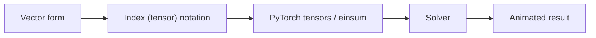
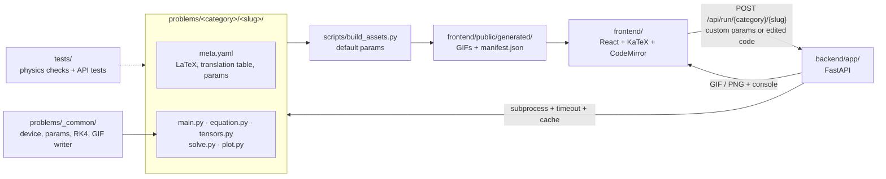

# Tensorizer

[](https://github.com/jackyko1991/tensorizer/actions/workflows/ci.yml)
[](https://github.com/jackyko1991/tensorizer/actions/workflows/pages.yml)
[](https://github.com/jackyko1991/tensorizer/actions/workflows/runner-image.yml)
[](https://github.com/jackyko1991/tensorizer/pkgs/container/tensorizer-runner)

**An education tool to study physics equation conversion to tensor form, PyTorch implementation, solving and visualization.**

Tensorizer standardizes the conversion of physics equations into GPU-accelerated tensors through the following workflow:



For example, the projectile with air drag:

```math
m\,\ddot{\mathbf r} = m\,\mathbf g - c\,\lVert\dot{\mathbf r}\rVert\,\dot{\mathbf r}
```

first convert to the tensor notation form:
```math
\ddot x_{bi} = g_i - k\,\sqrt{v_{bj}v_{bj}}\;v_{bi}
```

Here $b$ indexes a batch of balls and $i, j$ are spatial components. The repeated index $j$ is summed, which is exactly `torch.einsum('bj,bj->b', v, v)`. The trajectory solution is integrated via RK4 with animated visualization.

## Try it

**Live site: <https://jackyko1991.github.io/tensorizer/>**. It shows every problem's equations, code and prebuilt animation. Re-running with your own parameters goes to the shared cloud backend (a free Hugging Face Space with a run queue, see [docs/deploy-huggingface.md](docs/deploy-huggingface.md)). Pick **This computer** in the top bar to run on your own CPU/GPU instead: clone the repository and start `pixi run api`, then the public site sends runs to `localhost`.

The app has three tabs:

| Tab | What it is |
|---|---|
| **Problems** | The workspace: problem library, equations and setup sketch, five code files, parameters, terminal and plot/animation |
| **Concept** | How every problem works, step by step, using the simple pendulum (its real code is shown) |
| **Coding Skills** | The PyTorch techniques behind the library (broadcasting, einsum, RK4, eigh, FFT, autograd, …), each with an example and links to problems |

Every problem can also be taken to a notebook: **Open in Colab** opens it in Google Colab (switch the runtime to GPU and the code uses it automatically), and **Download .ipynb** saves your current version, including edited code and parameters. The notebooks live in [notebooks/](notebooks) and are regenerated from the problem files by `pixi run build-assets` or `pixi run notebooks`.

**Ask AI**: the tensor-face button at the bottom right opens the AI Assistant. Tensorizer builds no agent of its own; you bring one, three ways:
- **Local**: *Search this computer* finds agent CLIs on the machine running the backend (Claude Code, and experimental adapters for the OpenAI Codex CLI, OpenCode and the Gemini CLI) and uses that machine's own login.
- **Cloud**: Tensorizer is also an MCP connector (`/mcp`, with a per-browser token), so any cloud agent that supports custom MCP connectors can open, edit and run problems here.
- **API**: an Anthropic or OpenRouter key (or *Sign in with OpenRouter*), kept only in your browser tab.

The assistant sees what you see: the open problem or notebook, your edited code and parameters, any text you highlight (code, equations, summary, notebook cells, terminal) and, if you click 📷, a screenshot. Its edits land straight back in the editors. Agents are confined to the problem's own folder plus a `run_problem` tool.

**Workspace**: next to the library (left-panel tabs *Problems | Workspace*, or click the Tensorizer logo for the workspace home) you can create your own problems: blank, copied from the library, or written by the AI. Each problem has its Source (five code files and `meta.yaml`, editable inline, as Markdown or as YAML), any number of notebooks (Markdown and Python cells with inline plots) and a Data folder for your own files (CSV, JSON, NumPy, images) that your code, notebooks and the AI can load. Everything is saved in your browser; export it as a zip (a ready-to-run pixi project) or push it to a new GitHub repository with your own token. Cloud save and GPU runs are planned for Tensorizer Pro.

On phones the workspace splits into four tabs: Problem, Formulation, Code and Results. Add `?lang=<code>` to a link (for example `?lang=ja`) to open it in a given language; the address bar always shows the current one.

The interface and all problem text are available in 10 languages: English, 繁體中文, 简体中文, Français, Deutsch, Español, 日本語, Русский, 한국어 and हिन्दी. Equations and code stay the same in every language. Check translation coverage with `pixi run i18n-status`; [scripts/i18n.py](scripts/i18n.py) exports what needs translating and validates imports.

## Problem library

<!-- library:start -->
233 problems in 19 topics by difficulty level. Click a topic to expand it.

<details>
<summary><b>Mechanics</b> (13 problems)</summary>

<details>
<summary>🟢 Beginner (3)</summary>

| Problem | Key equation |
|---|---|
| [Simple pendulum beyond small angles](problems/mechanics/simple_pendulum) | $\ddot\theta_b = -\frac{g}{L}\,\sin\theta_b$ |
| [Projectile with air drag](problems/mechanics/projectile) | $\ddot x_{bi} = g_i - \tfrac{c}{m}\,\sqrt{v_{bj}v_{bj}}\;v_{bi}$ |
| [Block on an inclined plane with friction](problems/mechanics/inclined_plane) | $a_{bi} = g_i + \tfrac{1}{m}N_{bi} + \tfrac{1}{m}f_{bi}$ |

</details>

<details>
<summary>🟠 Intermediate (4)</summary>

| Problem | Key equation |
|---|---|
| [Coupled oscillators and normal modes](problems/mechanics/coupled_oscillators) | $m\,\ddot x_i = -K_{ij}\,x_j$ |
| [Double pendulum and chaos](problems/mechanics/double_pendulum) | $M_{bij}(q)\,\ddot q_{bj} = f_{bi}(q, \dot q)$ |
| [Free rigid-body rotation (tennis-racket effect)](problems/mechanics/rigid_body_rotation) | $I_{ij}\,\dot\omega_j + \varepsilon_{ijk}\,\omega_j\,I_{kl}\,\omega_l = 0$ |
| [Hamiltonian mechanics: phase space and symplectic integration](problems/mechanics/hamiltonian_phase_space) | $\dot z_{ba} = J_{ac}\,\frac{\partial H}{\partial z_{bc}}$ |

</details>

<details>
<summary>🔴 Advanced (6)</summary>

| Problem | Key equation |
|---|---|
| [N-body gravity in 3D](problems/mechanics/n_body_gravity) | $\ddot x_{ai} = G\,m_b\,(r_{abj}r_{abj} + \varepsilon^2)^{-3/2}\,r_{abi}$ |
| [Equations of motion from a Lagrangian by autograd](problems/mechanics/lagrangian_autograd) | $\ddot q_i = H^{-1}_{ij}\Big(\frac{\partial L}{\partial q_j} - C_{jk}\,\dot q_k\Big)$ |
| [Mass–spring cloth](problems/mechanics/mass_spring_cloth) | $m\,\ddot x_{ai} = -k\,D_{ea}\,(\lVert d_e\rVert - \ell_0)\,\hat d_{ei} + m\,g_i$ |
| [Three-body chaos: the Pythagorean problem](problems/mechanics/three_body_chaos) | $\ddot x_{kai} = G\,m_b\,(r_{kabj}r_{kabj})^{-3/2}\,r_{kabi},\;\; \lVert\Delta\rVert \propto e^{\lambda t}$ |
| [Principle of least action: finding the path by gradient descent](problems/mechanics/least_action) | $S_b = \sum_{n=0}^{N-1}\Big[\tfrac12 m\,v_{bn}v_{bn} - V(q_{bn})\Big]\Delta t$ |
| [E(n)-equivariant graph neural network for particle dynamics](problems/mechanics/egnn_dynamics) | $r_{ija} = x_{ia} - x_{ja}$ |

</details>

</details>

<details>
<summary><b>Optics</b> (10 problems)</summary>

<details>
<summary>🟢 Beginner (3)</summary>

| Problem | Key equation |
|---|---|
| [Snell's law in layered media](problems/optics/snell_refraction) | $t_{ri} = \eta_r\,d_{ri} + \left(\eta_r c_r - \sqrt{1-\eta_r^2(1-c_r^2)}\right) n_{ri}$ |
| [Reflection from plane and curved mirrors](problems/optics/mirror_reflection) | $r_{ri} = d_{ri} - 2\,(d_{rj}\,n_{rj})\,n_{ri}$ |
| [Image formed by a thin lens](problems/optics/thin_lens_image) | $s'_k = \left(\frac{1}{f} - \frac{1}{s_k}\right)^{-1}$ |

</details>

<details>
<summary>🟠 Intermediate (3)</summary>

| Problem | Key equation |
|---|---|
| [Two-lens system with ray-transfer matrices](problems/optics/lens_system) | $y'_{ri} = M_{ij}\,y_{rj}$ |
| [Diffraction grating as a sum of phasors](problems/optics/diffraction_grating) | $E_t = A_n\,P_{nt}$ |
| [Polarization with Jones matrices](problems/optics/polarization_jones) | $E^{\text{out}}_i = P_{ij}\,W_{jk}\,E^{\text{in}}_k$ |

</details>

<details>
<summary>🔴 Advanced (4)</summary>

| Problem | Key equation |
|---|---|
| [Double-slit interference](problems/optics/double_slit) | $\partial_t^2 u = c^2\,\partial_i\partial_i u$ |
| [Fraunhofer diffraction as a 2D Fourier transform](problems/optics/fourier_optics) | $U_{kl} = F_{ka}\,A_{ab}\,F_{lb}$ |
| [Road mirage from the ray equation](problems/optics/grin_mirage) | $\frac{d}{ds}\Big(n\,\frac{dr_i}{ds}\Big) = \partial_i n$ |
| [Inverse design of a metalens](problems/optics/metalens_inverse_design) | $\hat E_{lq} = F_{qx}\,A_x\,e^{i\varphi_{lx}}$ |

</details>

</details>

<details>
<summary><b>Waves</b> (10 problems)</summary>

<details>
<summary>🟢 Beginner (3)</summary>

| Problem | Key equation |
|---|---|
| [Standing waves on a string](problems/waves/standing_waves) | $\ddot u_{bi} = c^2\,D_{ij}\,u_{bj}$ |
| [Beats and group velocity](problems/waves/beats_superposition) | $y_{nj} = A_s\cos\theta_{snj}$ |
| [Doppler effect and Mach cone](problems/waves/doppler_effect) | $t_{oe} = t_e + \tfrac{1}{c}\sqrt{(o_{oi} - s_{ei})(o_{oi} - s_{ei})}$ |

</details>

<details>
<summary>🟠 Intermediate (3)</summary>

| Problem | Key equation |
|---|---|
| [Pulse at a string junction](problems/waves/string_junction) | $\mu_i\,\ddot u_i = T\,D_{ij}\,u_j$ |
| [Dispersive water waves](problems/waves/dispersive_waves) | $\hat a_{nk} = \hat a_k\,e^{-i\omega_k t_n}$ |
| [Vibrating drum modes](problems/waves/membrane_modes) | $\Delta_{(ab)(cd)} = D_{ac}\,\delta_{bd} + \delta_{ac}\,D_{bd}$ |

</details>

<details>
<summary>🔴 Advanced (4)</summary>

| Problem | Key equation |
|---|---|
| [KdV soliton collision](problems/waves/kdv_solitons) | $\partial_t \hat u_k = i k^3\,\hat u_k - 3ik\,F_{kj}\,(u_j u_j)$ |
| [Rogue waves (nonlinear Schrödinger)](problems/waves/nonlinear_schrodinger) | $\psi_j \leftarrow F^{-1}_{jk}\,e^{-ik^2\Delta t/4}\,F_{kl}\,\psi_l$ |
| [Ripple tank interference](problems/waves/ripple_tank) | $(\nabla^2 u)_{ab} = \frac{1}{h^2}\,K_{\alpha\beta}\,u_{a+\alpha,\,b+\beta}$ |
| [Photonic time crystal and time reflection](problems/waves/photonic_time_crystal) | $\dot u_{ka} = A_{kab}(t)\,u_{kb}$ |

</details>

</details>

<details>
<summary><b>Thermodynamics</b> (11 problems)</summary>

<details>
<summary>🟢 Beginner (3)</summary>

| Problem | Key equation |
|---|---|
| [Carnot cycle of an ideal gas](problems/thermodynamics/carnot_cycle) | $W = \oint p\,dV,\;\; \eta = 1 - T_c/T_h$ |
| [Newton's law of cooling](problems/thermodynamics/newton_cooling) | $\dot T_b = -k_b\,(T_b - T_{\text{env}})$ |
| [Four ideal-gas processes](problems/thermodynamics/ideal_gas_processes) | $W = \int p\,dV,\;\; Q = \Delta U + W$ |

</details>

<details>
<summary>🟠 Intermediate (4)</summary>

| Problem | Key equation |
|---|---|
| [Heat diffusion on a plate](problems/thermodynamics/heat_diffusion) | $\partial_t T = \alpha\,\partial_i\partial_i T$ |
| [Random walk and diffusion](problems/thermodynamics/random_walk_diffusion) | $\langle x_i x_i\rangle = 2dDt$ |
| [Black-body radiation](problems/thermodynamics/blackbody_radiation) | $u_{ab} = \frac{8\pi h c}{\lambda_b^5}\,\frac{1}{\exp\!\big(hc / \lambda_b k T_a\big) - 1}$ |
| [Maxwell's demon, the Szilard engine and Landauer's principle](problems/thermodynamics/maxwell_demon) | $y_b = x_b + F_b\,\Delta t + \sqrt{2\Delta t}\,\xi_b$ |

</details>

<details>
<summary>🔴 Advanced (4)</summary>

| Problem | Key equation |
|---|---|
| [Kinetic theory of an ideal gas](problems/thermodynamics/kinetic_gas) | $v'_{ai} = v_{ai} - (\Delta v_{abj}\,n_{abj})\,n_{abi}$ |
| [2D Ising model](problems/thermodynamics/ising_model) | $h_{ij} = K_{kl}\,s_{i+k,\,j+l}$ |
| [Van der Waals gas and Maxwell's construction](problems/thermodynamics/van_der_waals) | $p_{tv} = \frac{nRT_t}{V_v - nb} - \frac{an^2}{V_v^2}$ |
| [Markovian Mpemba effect](problems/thermodynamics/mpemba_effect) | $W_{ij} = A_{ij}\min\!\big(1, e^{-(U_i - U_j)/T_b}\big) - \delta_{ij}\textstyle\sum_k A_{kj}\min\!\big(1, e^{-(U_k - U_j)/T_b}\big)$ |

</details>

</details>

<details>
<summary><b>Electromagnetism</b> (10 problems)</summary>

<details>
<summary>🟢 Beginner (3)</summary>

| Problem | Key equation |
|---|---|
| [Charged particles in E and B fields](problems/em/lorentz_force) | $m_b\,\dot v_{bi} = q_b\,\big(E_i + \varepsilon_{ijk}\,v_{bj}\,B_k\big)$ |
| [Electric field of point charges](problems/em/coulomb_field) | $E_{gi} = k\,Q_q\,\frac{r_{gqi}}{\big(r_{gqj}\,r_{gqj}\big)^{3/2}}$ |
| [Charging a capacitor (RC circuit)](problems/em/rc_circuit) | $\dot V_b = \frac{V_s - V_b}{R_b\,C}$ |

</details>

<details>
<summary>🟠 Intermediate (3)</summary>

| Problem | Key equation |
|---|---|
| [Electrostatic potential (Poisson equation)](problems/em/electrostatics) | $\partial_i\partial_i\,\phi = -\rho/\varepsilon_0 \;\;\longrightarrow\;\; L_{nm}\,\phi_m = -\rho_n/\varepsilon_0$ |
| [Magnetic field of current loops (Biot–Savart)](problems/em/biot_savart) | $B_{gi} = \frac{\mu_0 I}{4\pi}\,\varepsilon_{ijk}\,dl_{sj}\,\frac{r_{gsk}}{\big(r_{gsl}\,r_{gsl}\big)^{3/2}}$ |
| [Electromagnetic waves (FDTD)](problems/em/em_wave_fdtd) | $\partial_t H_i = -\varepsilon_{ijk}\,\partial_j E_k$ |

</details>

<details>
<summary>🔴 Advanced (4)</summary>

| Problem | Key equation |
|---|---|
| [Lorentz boost of the field tensor](problems/em/field_tensor_boost) | $F'^{\mu\nu} = \Lambda^{\mu}{}_{\alpha}\,\Lambda^{\nu}{}_{\beta}\,F^{\alpha\beta}$ |
| [Relativistic charged particle](problems/em/relativistic_particle) | $\frac{dU^\mu}{d\tau} = \frac{q}{m}\,F^{\mu}{}_{\nu}\,U^\nu$ |
| [Rectangular waveguide modes](problems/em/waveguide_modes) | $\partial_i\partial_i\,\psi + k_c^2\,\psi = 0 \;\;\longrightarrow\;\; -L_{nm}\,\psi_m = k_c^2\,\psi_n$ |
| [Topological photonics on a Haldane lattice](problems/em/topological_photonics) | $i\dot\psi_i = H_{ij}\psi_j$ |

</details>

</details>

<details>
<summary><b>Fluids & Continuum</b> (13 problems)</summary>

<details>
<summary>🟢 Beginner (3)</summary>

| Problem | Key equation |
|---|---|
| [Hydrostatic pressure and buoyancy](problems/fluids/hydrostatics_buoyancy) | $p = p_0 + \rho_w\,g_i x_i$ |
| [Bernoulli and the Venturi tube](problems/fluids/bernoulli_venturi) | $A_k\,u_k = Q$ |
| [Draining a tank (Torricelli)](problems/fluids/torricelli_draining) | $\dot h_b = -\frac{a_b}{A}\,\sqrt{2 g\,h_b}$ |

</details>

<details>
<summary>🟠 Intermediate (3)</summary>

| Problem | Key equation |
|---|---|
| [Burgers equation and shock formation](problems/fluids/burgers_shock) | $\dot u_i = -\tfrac12\,D_{ij}\,u_j^2 + \nu\,L_{ij}\,u_j$ |
| [Navier–Stokes pipe flow](problems/fluids/navier_stokes_pipe_flow) | $\rho\,(\partial_t u_i + u_j\,\partial_j u_i) = -\partial_i p + \mu\,\partial_j\partial_j u_i$ |
| [Stress, strain and Mohr's circle](problems/fluids/stress_strain) | $\varepsilon_{ij} = \tfrac12(\partial_i u_j + \partial_j u_i)$ |

</details>

<details>
<summary>🔴 Advanced (7)</summary>

| Problem | Key equation |
|---|---|
| [Lid-driven cavity (Navier–Stokes)](problems/fluids/lid_driven_cavity) | $\partial_t\omega + u_j\,\partial_j\omega = \nu\,\partial_j\partial_j\omega$ |
| [Flow past a cylinder: drag and vortex shedding](problems/fluids/cylinder_drag) | $f_i(\mathbf x + \mathbf e_i, t + 1) = f_i - \tfrac1\tau\big(f_i - f_i^\text{eq}\big)$ |
| [Elastic P and S waves](problems/fluids/elastic_waves) | $\rho\,\ddot u_i = (\lambda + \mu)\,\partial_i\partial_j u_j + \mu\,\partial_j\partial_j u_i + f_i$ |
| [Machine-learning–accelerated CFD](problems/fluids/ml_accelerated_cfd) | $\dot u_{bi} = -\frac{F_{b,i+\frac12} - F_{b,i-\frac12}}{\Delta x}$ |
| [Navier–Stokes regularity and blowup candidates](problems/fluids/navier_stokes_blowup) | $\partial_t\hat u_{bi} = P_{ij}\,\widehat{(\mathbf u\times\boldsymbol\omega)}_{bj} - \nu_b\,k_lk_l\,\hat u_{bi}$ |
| [Searching for self-similar blow-up profiles](problems/fluids/blowup_profile_search) | $R_{bn} = -\lambda_b U_{bn} + \big((1+\lambda_b)\,y_{bn} + U_{bn}\big)\,U'_{bn}$ |
| [Digital wind tunnel: 3D lattice Boltzmann around an STL airplane](problems/fluids/lbm_wind_tunnel) | $f_i(\mathbf x + \mathbf e_i, t + 1) = f_i - \omega^+\Delta_i^+ - \omega^-\Delta_i^-$ |

</details>

</details>

<details>
<summary><b>Quantum</b> (13 problems)</summary>

<details>
<summary>🟢 Beginner (3)</summary>

| Problem | Key equation |
|---|---|
| [Particle in a box](problems/quantum/infinite_well) | $H_{xy}\,\varphi_{yn} = E_n\,\varphi_{xn}$ |
| [Quantum harmonic oscillator](problems/quantum/harmonic_oscillator) | $H_{xy}\,\varphi_{yn} = E_n\,\varphi_{xn},\;\; V_x = \tfrac12\omega^2 x^2$ |
| [Free wave packet](problems/quantum/free_wave_packet) | $\tilde\psi_{tk} = e^{-ik_k^2 t_t/2}\,\tilde\psi_k$ |

</details>

<details>
<summary>🟠 Intermediate (6)</summary>

| Problem | Key equation |
|---|---|
| [Spin precession and Rabi flopping](problems/quantum/spin_precession) | $H_{ab} = -\tfrac{\gamma}{2}\,B_k\,\sigma_{kab}$ |
| [Hydrogen atom orbitals](problems/quantum/hydrogen_radial) | $H_{lij}\,u_{ljn} = E_{ln}\,u_{lin}$ |
| [Tunnelling in a double well](problems/quantum/double_well) | $H_{xy}\,\varphi_{yn} = E_n\,\varphi_{xn}$ |
| [Schrödinger equation: Crank–Nicolson time stepping](problems/quantum/schrodinger_crank_nicolson) | $H_{xy} = -\tfrac12\,D2_{xy} + V_x\,\delta_{xy}$ |
| [Matrix mechanics: Heisenberg's oscillator from ladder operators](problems/quantum/matrix_mechanics) | $a_{mn} = \sqrt n\,\delta_{m,n-1}$ |
| [Photoelectric effect and light quanta](problems/quantum/photoelectric_effect) | $K_{ifn} = h\,\nu_f - \phi - \varepsilon_{ifn}$ |

</details>

<details>
<summary>🔴 Advanced (4)</summary>

| Problem | Key equation |
|---|---|
| [Quantum tunnelling](problems/quantum/tunneling) | $\psi_x \leftarrow F^{-1}_{xk}\,K_k\,F_{ky}\,P_y\,\psi_y$ |
| [2D wave-packet scattering](problems/quantum/scattering_2d) | $\psi \leftarrow P\,\mathcal F^{-1} K\,\mathcal F\,P\,\psi$ |
| [Two-qubit entanglement](problems/quantum/two_qubit_entanglement) | $\psi_{ab} \leftarrow G_{abcd}\,\psi_{cd}$ |
| [Quantum error correction below threshold](problems/quantum/error_correction_threshold) | $x_{sti} = \bigoplus_{t'\le t} e_{st'i}$ |

</details>

</details>

<details>
<summary><b>Astrophysics & Relativity</b> (16 problems)</summary>

<details>
<summary>🟢 Beginner (3)</summary>

| Problem | Key equation |
|---|---|
| [Kepler's laws of planetary motion](problems/astro/kepler_orbits) | $\ddot x_{bi} = -GM\,(x_{bj}x_{bj})^{-3/2}\,x_{bi}$ |
| [Escape velocity](problems/astro/escape_velocity) | $\ddot x_{bi} = -GM\,(x_{bj}x_{bj})^{-3/2}\,x_{bi}$ |
| [Hubble expansion](problems/astro/hubble_expansion) | $x_{tgi} = a_t\,q_{gi}$ |

</details>

<details>
<summary>🟠 Intermediate (6)</summary>

| Problem | Key equation |
|---|---|
| [Special relativity: Minkowski diagrams and Lorentz boosts](problems/astro/minkowski_diagram) | $x'^\mu = \Lambda^\mu{}_\nu\,x^\nu$ |
| [Lagrange points of the restricted three-body problem](problems/astro/lagrange_points) | $\ddot x_i = -m_s\,\frac{(x - x_s)_i}{\lvert x - x_s\rvert^3} - 2\,\varepsilon_{ijk}\Omega_j\dot x_k - \varepsilon_{ijk}\Omega_j\,\varepsilon_{klm}\Omega_l x_m$ |
| [Spaghettification near a black hole](problems/astro/tidal_tensor) | $\ddot\xi_{bi} = T_{ij}\,\xi_{bj}$ |
| [Hohmann and bi-elliptic orbit transfers](problems/astro/orbit_transfer) | $\ddot x_{bi} = -\mu\,x_{bi}\,(x_{bj}x_{bj})^{-3/2}$ |
| [Einstein 1905: moving bodies and $E = mc^2$](problems/astro/einstein_1905_relativity) | $x'^\mu = \Lambda^\mu{}_\nu\,x^\nu$ |
| [Weighing Sgr A*: the orbit of the star S2](problems/astro/sgr_a_star_orbits) | $E_{bt} \leftarrow E_{bt} - \frac{E_{bt} - e_b\sin E_{bt} - M_{bt}}{1 - e_b\cos E_{bt}}$ |

</details>

<details>
<summary>🔴 Advanced (7)</summary>

| Problem | Key equation |
|---|---|
| [General relativity: orbits and infall around a black hole](problems/astro/black_hole_geodesics) | $\frac{d^2x^\mu}{d\tau^2} = -\Gamma^\mu{}_{\alpha\beta}\,\dot x^\alpha\dot x^\beta$ |
| [Hawking radiation and black-hole evaporation](problems/astro/hawking_radiation) | $T_m = \frac{\hbar c^3}{8\pi G k_B}\,M_m^{-1}$ |
| [Gravitational lensing by a black hole](problems/astro/gravitational_lensing) | $u_b'' = -u_b + 3M\,u_b^2$ |
| [Pulsar timing array and the Hellings–Downs curve](problems/astro/pulsar_timing_hellings_downs) | $e^{+}_{mij} = m_im_j - n_in_j$ |
| [Kerr–Newman black holes: horizons, ergosphere and naked singularities](problems/astro/kerr_newman_ergosphere) | $r_{\pm,b} = M_b \pm \sqrt{M_b^2 - a_b^2 - Q_b^2}$ |
| [Re-igniting dead stars: brown dwarfs, novae, X-ray bursts and black holes](problems/astro/dead_star_reignition) | $T_{by}^4 = T_{{\rm floor},b}^4 + \frac{3\kappa_{by}\,y_y\,F_{by}}{a c}$ |
| [GW150914: the first gravitational-wave chirp](problems/astro/gw150914_chirp) | $S_{dk} = \frac{2}{f_s\,w_nw_n}\,\big\langle \vert X_{dsk}\vert ^2\big\rangle_s$ |

</details>

</details>

<details>
<summary><b>Cosmology & New Physics</b> (19 problems)</summary>

<details>
<summary>🟠 Intermediate (3)</summary>

| Problem | Key equation |
|---|---|
| [The CMB as a perfect blackbody (COBE FIRAS)](problems/cosmology/cmb_blackbody) | $I_{bf} = 2hc\,\tilde\nu_f^3\big[(e^{x_{bf}+\mu_b}-1)^{-1} + y_b\,Y(x_{bf})\big]$ |
| [Galaxy rotation curves and dark matter](problems/cosmology/dark_matter_rotation) | $V^2_{gr} = V^2_{\mathrm{gas},gr} + \Upsilon_{d,g} V^2_{\mathrm{disk},gr} + \Upsilon_{b,g} V^2_{\mathrm{bul},gr} + V^2_{\mathrm{halo}}(r_{gr};\,V_{s,g}, r_{s,g})$ |
| [Tachyons and the antitelephone](problems/cosmology/tachyons) | $x'^a_{Bn} = \Lambda^a{}_b(\beta_B)\,x^b_n$ |

</details>

<details>
<summary>🔴 Advanced (16)</summary>

| Problem | Key equation |
|---|---|
| [Relativistic string modes and T-duality](problems/cosmology/string_modes) | $X_{tsi} = \sqrt{2\alpha'}\,\mathrm{Re}\Big[E^{(R)}_{tsn}\,\tfrac{i}{n}\,\alpha_{ni} + E^{(L)}_{tsn}\,\tfrac{i}{n}\,\tilde\alpha_{ni}\Big]$ |
| [Quantum cosmology: the loop bounce](problems/cosmology/quantum_gravity_toy) | $\dot y_{bk} = f_k(y_b;\,p_b,\lambda_b)$ |
| [Variable speed of light and the horizon problem](problems/cosmology/variable_speed_of_light) | $r^H_{ma} = \frac{c_{ma}}{a_a H_{ma}}$ |
| [Fitting the cosmological constant to supernovae](problems/cosmology/cosmological_constant_fit) | $\chi_{abk} = \sum_{k'<k}\tfrac{h}{2}\big(E^{-1}_{abk'} + E^{-1}_{ab,k'+1}\big)$ |
| [The axis of evil in the microwave sky](problems/cosmology/axis_of_evil) | $r = \arg\min\ w_p\big(T_p - Y_{pa}\,r_a\big)^2$ |
| [Why is there more matter than antimatter?](problems/cosmology/baryon_asymmetry) | $\Delta_{k,n+1} = \Delta_{kn}\,e^{-D_kh} - \frac{dN^{eq}}{dz}\,h\,\varphi(D_kh)$ |
| [The hierarchy problem and gravity leaking into extra dimensions](problems/cosmology/hierarchy_extra_dimensions) | $r_n(m) = \big[\vartheta(q)^n\big]_m$ |
| [Slow-roll inflation and the (n_s, r) plane](problems/cosmology/inflation_slow_roll) | $\frac{d\phi_b}{dN} = \psi_b$ |
| [Big Bang nucleosynthesis](problems/cosmology/big_bang_nucleosynthesis) | $\frac{dY_{bi}}{du} = \frac{dt}{du}\,S_{ri}\big(\lambda^+_{br} M^+_{br} - \lambda^-_{br} M^-_{br}\big)$ |
| [The projection postulate: one high-dimensional state, many shadows](problems/cosmology/projection_postulate) | $q_{tD} = \frac{\sum_{i\leq d}\vert z_{ti}\vert ^2}{\sum_{i\leq D}\vert z_{ti}\vert ^2}$ |
| [One particle seen many times: slicing a single worldline](problems/cosmology/projection_one_particle) | $X_{bsi} = \sigma_k\,a_{bikc}\,\phi_{ksc}$ |
| [How many dimensions? The budget of the projection hypothesis](problems/cosmology/projection_dimension_budget) | $F_r = \vert S^{n+2}\vert \,r^{n+2}\,\langle \partial_i\phi\,u_{pi}\rangle_p$ |
| [Singularities as folds of a projection](problems/cosmology/projection_singularity_fold) | $g_{bij} = J_{bAi}\,\eta_{AC}\,J_{bCj}$ |
| [Bell tests of the projection race](problems/cosmology/projection_bell_test) | $w_{bij} = \bar\psi_{xy}\,(P^a)_{bixu}\,(P^b)_{bjyv}\,\psi_{uv}$ |
| [Telescope tests of the projection: gravitational waves, black-hole shadows and supernovae](problems/cosmology/projection_telescope_tests) | $\mathcal L(x) = \frac{\sum_i w_i\,K_h(x - d_i)}{\sum_i w_i}$ |
| [Where could the antimatter be? Criteria for an antimatter universe](problems/cosmology/projection_antimatter_universe) | $J_{de} = \frac{c}{4\pi}\sum_z R_{dz}\,H_z^{-1}\,\Delta z_z\,S_{ez}$ |

</details>

</details>

<details>
<summary><b>Nuclear & Particle</b> (15 problems)</summary>

<details>
<summary>🟢 Beginner (3)</summary>

| Problem | Key equation |
|---|---|
| [Radioactive decay](problems/nuclear/radioactive_decay) | $s_n(t+\Delta t) = s_n(t)\,\big[u_n \ge p\big]$ |
| [Decay chain (Bateman equations)](problems/nuclear/decay_chain) | $\dot N_i = A_{ij}\,N_j$ |
| [Nuclear binding energy](problems/nuclear/binding_energy) | $B_{zn} = a_V A_{zn} - a_S A_{zn}^{2/3} - a_C\,\frac{Z_z(Z_z-1)}{A_{zn}^{1/3}} - a_A\,\frac{(N_n-Z_z)^2}{A_{zn}} + \delta_{zn}$ |

</details>

<details>
<summary>🟠 Intermediate (3)</summary>

| Problem | Key equation |
|---|---|
| [Rutherford scattering](problems/nuclear/rutherford_scattering) | $\ddot x_{bi} = \frac{k}{m}\,\frac{x_{bi}}{(x_{bj}x_{bj})^{3/2}}$ |
| [Neutrino oscillations](problems/nuclear/neutrino_oscillations) | $A_{k\beta\alpha} = U_{\beta i}\,U^*_{\alpha i}\,e^{-i\,m_i^2 L_k/2E}$ |
| [Four-momentum and two-body decay](problems/nuclear/four_momentum) | $p_\mu p^\mu = \eta_{\mu\nu}\,p^\mu p^\nu = m^2$ |

</details>

<details>
<summary>🔴 Advanced (9)</summary>

| Problem | Key equation |
|---|---|
| [Nuclear shell model](problems/nuclear/shell_model) | $H_{kij} = -\frac{\hbar^2}{2m}D_{ij} + \Big[V_k(r_i) + \frac{\hbar^2 l_k(l_k+1)}{2m r_i^2}\Big]\delta_{ij}$ |
| [Reactor criticality](problems/nuclear/reactor_criticality) | $M_{ij}\,\phi_j = \frac1k\,F_{ij}\,\phi_j$ |
| [Electromagnetic shower](problems/nuclear/em_shower) | $(E_p, s_p) \to \big(\tfrac{E_p}{2}, 1\big),\ \big(\tfrac{E_p}{2}, 1 - s_p\big)\ \text{ if } \tfrac{E_p}{2} \ge E_c$ |
| [Feynman diagram: $e^+e^- \to \mu^+\mu^-$ from Dirac traces](problems/nuclear/feynman_ee_mumu) | $\overline{\vert \mathcal M\vert ^2} = \frac{e^4}{4s^2}\,L^{\mu\nu}M_{\mu\nu}$ |
| [Inertial-fusion ignition of a DT hot spot](problems/nuclear/fusion_ignition) | $P^{\alpha}_b = \tfrac14 n^2(1-\varphi_b)^2\langle\sigma v\rangle(T_b)\,E_\alpha$ |
| [Yang–Mills on the lattice and the mass gap](problems/nuclear/yang_mills_mass_gap) | $P_{\mu\nu}(x) = U_\mu(x)\,U_\nu(x+\hat\mu)\,U_\mu^\dagger(x+\hat\nu)\,U_\nu^\dagger(x)$ |
| [Time reversal and CPT with neutral kaons](problems/nuclear/kaon_cp_violation) | $H_{ab} = V_{ai}\,\lambda_i\,[V^{-1}]_{ib}$ |
| [Finding the Higgs boson in real diphoton data](problems/nuclear/higgs_boson) | $B_{bn} = w_n\exp(X_{nk}\theta_{bk})$ |
| [Particle track finding as an integer program](problems/nuclear/ilp_track_finding) | $\sum_{e\in\mathrm{out}(h)} y_e \le 1$ |

</details>

</details>

<details>
<summary><b>Physical Chemistry</b> (9 problems)</summary>

<details>
<summary>🟢 Beginner (3)</summary>

| Problem | Key equation |
|---|---|
| [Rate laws and the Arrhenius plot](problems/physchem/arrhenius_kinetics) | $\frac{d[\mathrm A]_{ot}}{dt} = -k_t\,[\mathrm A]_{ot}^{\,n_o}$ |
| [Chemical equilibrium and Le Chatelier](problems/physchem/chemical_equilibrium) | $n_{bi} = n^0_{bi} + \nu_i\,\xi_b$ |
| [Beer–Lambert spectra of A → B → C](problems/physchem/beer_lambert_kinetics) | $D_{tw} = l\,E_{ws}\,c_{ts}$ |

</details>

<details>
<summary>🟠 Intermediate (3)</summary>

| Problem | Key equation |
|---|---|
| [Particle in a box and the colour of dyes](problems/physchem/particle_box_dyes) | $E_{bn} = \frac{h^2}{8m_e}\,\frac{n_n n_n}{L_b L_b}$ |
| [HCl rovibrational spectrum](problems/physchem/hcl_rovibrational) | $F_{viJ} = B_{vi}\,J(J+1) - D_i\,J^2(J+1)^2$ |
| [Nernst equation and Debye–Hückel screening](problems/physchem/nernst_debye_huckel) | $E_{tq} = E^\circ - s_t\,\log_{10}Q_q$ |

</details>

<details>
<summary>🔴 Advanced (3)</summary>

| Problem | Key equation |
|---|---|
| [Hartree–Fock for $\mathrm{H_2}$ in a minimal STO-3G basis](problems/physchem/hartree_fock_h2) | $S_{\mu\nu} = c_{\mu p}\,c_{\nu q}\,S_{\mu\nu pq}$ |
| [Marcus theory of electron transfer and the inverted region](problems/physchem/marcus_electron_transfer) | $k_{ltg} = \frac{2\pi}{\hbar}\,\vert H_{AB}\vert ^2\,(4\pi\lambda_l k_BT_t)^{-1/2}\exp\!\Big[-\frac{(\Delta G^\circ_g + \lambda_l)^2}{4\lambda_l k_BT_t}\Big]$ |
| [Lennard-Jones fluid: molecular dynamics and the radial distribution function](problems/physchem/lj_liquid_rdf) | $d_{saij} = x_{sia} - x_{sja} - L_s\,\mathrm{round}\!\Big(\frac{x_{sia} - x_{sja}}{L_s}\Big)$ |

</details>

</details>

<details>
<summary><b>Chemistry</b> (9 problems)</summary>

<details>
<summary>🟢 Beginner (3)</summary>

| Problem | Key equation |
|---|---|
| [Balancing chemical equations (null space)](problems/chemistry/equation_balancing) | $M_{res} = C_{res}\,\sigma_{rs}$ |
| [Acid–base titration curves](problems/chemistry/acid_base_titration) | $f_{an} = h_{an} + \mathrm{Na}_n - \frac{K_w}{h_{an}} - C_{A,n}\,j\,\alpha_{anj} = 0$ |
| [Limiting reagent and percent yield](problems/chemistry/limiting_reagent_yield) | $n^0_{bs} = \frac{m^0_{bs}}{M_s}$ |

</details>

<details>
<summary>🟠 Intermediate (3)</summary>

| Problem | Key equation |
|---|---|
| [Hückel molecular orbitals of π systems](problems/chemistry/huckel_mo_theory) | $H_{bij} = \alpha\,\delta_{ij} + \beta A_{bij}$ |
| [Belousov–Zhabotinsky oscillator (Oregonator)](problems/chemistry/belousov_zhabotinsky) | $x_b \leftarrow \frac{x_b + \Delta t\,P_b/\varepsilon}{1 + \Delta t\,L_b/\varepsilon}$ |
| [Chapman mechanism and the ozone layer](problems/chemistry/chapman_ozone) | $\dot c_{as} = S_{sr}\,r_{ar}(c_a)$ |

</details>

<details>
<summary>🔴 Advanced (3)</summary>

| Problem | Key equation |
|---|---|
| [Chemical equilibrium by Gibbs energy minimisation](problems/chemistry/gibbs_minimisation) | $\frac{G_b}{RT_b} = n_{bj}\big(g_{bj} + \ln n_{bj} - \ln n_{\mathrm{tot},b} + \ln P\big)$ |
| [A graph neural network for molecules (message passing)](problems/chemistry/molecular_gnn) | $h^0_{mic} = \sigma(x_{mif}W_{fc} + b_c)$ |
| [Polymerisation kinetics and molecular-weight distributions](problems/chemistry/polymerisation_mwd) | $\dot P_{0x} = T_{xy}P_{0y} - 2P_{0x}P_{0y}\mathbb 1_y$ |

</details>

</details>

<details>
<summary><b>Medical Physics</b> (12 problems)</summary>

<details>
<summary>🟢 Beginner (3)</summary>

| Problem | Key equation |
|---|---|
| [X-ray attenuation and image contrast](problems/medical/xray_attenuation) | $L_{mx} = M_{myx}\,\Delta l_y$ |
| [MRI: T1 and T2 relaxation and image contrast](problems/medical/mri_relaxation) | $S_{sab} = PD_s\,\bigl(1 - e^{-TR_a/T_{1,s}}\bigr)\,e^{-TE_b/T_{2,s}}$ |
| [Doppler ultrasound: measuring blood flow](problems/medical/doppler_ultrasound) | $v_{tn} = v_{\max,t}\,\big(1 - r_n^2/R^2\big)$ |

</details>

<details>
<summary>🟠 Intermediate (3)</summary>

| Problem | Key equation |
|---|---|
| [Radon transform and CT reconstruction](problems/medical/radon_ct) | $p_{\theta s} = f_{\theta t s}\,\Delta t$ |
| [Bloch equations and the spin echo](problems/medical/bloch_spin_echo) | $\dot M_{ni} = \varepsilon_{ijk}\,M_{nj}\,\Omega_{nk} - R_{ij}\,(M_{nj} - M^0_j)$ |
| [PET: positron annihilation and image reconstruction](problems/medical/pet_mlem) | $a_{ei} = d_{ei} + \sigma_+\xi_{ei}$ |

</details>

<details>
<summary>🔴 Advanced (6)</summary>

| Problem | Key equation |
|---|---|
| [Proton therapy: the Bragg peak](problems/medical/proton_bragg_peak) | $\frac{dE_b}{dz} = -S(E_b)$ |
| [MRI k-space: imaging with gradients and Fourier transforms](problems/medical/mri_kspace) | $s_{uv} = E_{up}\,E_{vr}\,\rho_{pr}$ |
| [Diffusion tensor imaging: mapping nerve fibres](problems/medical/diffusion_tensor_imaging) | $S_{vg} = S_{0v}\,e^{-b\,\hat g_{gi}\,D_{vij}\,\hat g_{gj}}$ |
| [Photon-counting CT and material decomposition](problems/medical/photon_counting_ct) | $A_{rm} = \textstyle\int a_m\,dl$ |
| [Aneurysm CFD: the OpenFOAM + VMTK workflow, rebuilt with tensors](problems/medical/aneurysm_cfd) | $(\nabla\!\cdot\mathbf u)_c = \tfrac1h\Big(\sum_{o(f)=c}u_f - \sum_{n(f)=c}u_f\Big)$ |
| [The power of workflow orchestration: a Circle of Willis cohort as a tensor DAG](problems/medical/cow_workflow_dag) | $M_a^{sr} \in \{I_{n_a},\ \mathbb 1_{n_a},\ \mathbb 1_{n_a}^{\top}\}$ |

</details>

</details>

<details>
<summary><b>Biophysics</b> (8 problems)</summary>

<details>
<summary>🟢 Beginner (2)</summary>

| Problem | Key equation |
|---|---|
| [Receptor–ligand binding ($k_{\mathrm{on}}$, $k_{\mathrm{off}}$)](problems/biophysics/receptor_binding) | $J_{bc} = k^{\mathrm{on}}_b\,R_{bc}\,L_{bc} - k^{\mathrm{off}}_b\,C_{bc}$ |
| [Michaelis–Menten enzyme kinetics](problems/biophysics/michaelis_menten) | $\dot S_{bc} = -k^{1}_b E_{bc} S_{bc} + k^{-1}_b X_{bc}$ |

</details>

<details>
<summary>🟠 Intermediate (3)</summary>

| Problem | Key equation |
|---|---|
| [Hodgkin–Huxley action potential](problems/biophysics/hodgkin_huxley) | $\Gamma_{kb} = \big(m_b^3 h_b,\ n_b^4,\ 1\big)$ |
| [HP lattice protein folding](problems/biophysics/hp_lattice_folding) | $d_{rij} = x_{rik}x_{rik} + x_{rjk}x_{rjk} - 2\,x_{rik}x_{rjk}$ |
| [Stretching DNA, the worm-like chain](problems/biophysics/worm_like_chain) | $h_{bmik} = K\,(t_{bm,i-1,k} + t_{bm,i+1,k}) + f_b\,\delta_{kz}$ |

</details>

<details>
<summary>🔴 Advanced (3)</summary>

| Problem | Key equation |
|---|---|
| [AlphaFold in miniature: from a distance map to a 3D fold](problems/biophysics/mini_alphafold) | $\hat d_{ij} = p_{ijk}\,c_k$ |
| [Coarse-grained protein folding: a Gō model with Langevin dynamics](problems/biophysics/coarse_grained_md) | $r_{sp} = \sqrt{(x_{s i_p a} - x_{s j_p a})(x_{s i_p a} - x_{s j_p a})}$ |
| [Turing patterns: Gray–Scott reaction–diffusion](problems/biophysics/turing_patterns) | $(\nabla^2 u)_{bij} = \frac{u_{b,i+1,j} + u_{b,i-1,j} + u_{b,i,j+1} + u_{b,i,j-1} - 4u_{bij}}{h^2}$ |

</details>

</details>

<details>
<summary><b>Bioinformatics</b> (10 problems)</summary>

<details>
<summary>🟢 Beginner (3)</summary>

| Problem | Key equation |
|---|---|
| [k-mers, GC content and GC skew](problems/bioinformatics/kmer_gc_skew) | $m_n = U_{naj}\,P_{ja}$ |
| [Position weight matrix: motif logo and scan](problems/bioinformatics/pwm_motif_scan) | $C_{ja} = X_{sja}$ |
| [Hardy–Weinberg and Wright–Fisher genetic drift](problems/bioinformatics/wright_fisher_drift) | $G_{rg} = \big(p_r^2,\ 2p_rq_r,\ q_r^2\big)_g$ |

</details>

<details>
<summary>🟠 Intermediate (3)</summary>

| Problem | Key equation |
|---|---|
| [Sequence alignment as a wavefront of tensor updates](problems/bioinformatics/sequence_alignment) | $S_{bij} = a_{bi\alpha}\,W_{\alpha\beta}\,c_{bj\beta}$ |
| [Finding CpG islands with a hidden Markov model](problems/bioinformatics/hmm_cpg_islands) | $e_{btk} = x_{bt\alpha}E_{k\alpha}$ |
| [Phylogenetic trees from DNA distances](problems/bioinformatics/phylogenetic_tree) | $y_{l\beta} = x_{l\alpha}P_{\alpha\beta}(t)$ |

</details>

<details>
<summary>🔴 Advanced (4)</summary>

| Problem | Key equation |
|---|---|
| [Protein contacts from coevolution (DCA)](problems/bioinformatics/coevolution_contacts) | $E_{nia} = h_{ia} + J_{iajb}\,x_{njb}$ |
| [Single-cell RNA-seq: PCA and k-means clustering](problems/bioinformatics/single_cell_pca) | $n_c = K_{cg}\,\mathbb 1_g$ |
| [A tiny CNN finds a DNA binding motif](problems/bioinformatics/dna_binding_cnn) | $X_{npkb} = x_{n,p+k,b}$ |
| [A tiny protein language model learns contacts](problems/bioinformatics/protein_language_model) | $A_{nhij} = \mathrm{softmax}_j\Big(\frac{X_{nic}W^Q_{hck}\;X_{njc'}W^K_{hc'k}}{\sqrt{d_k}}\Big)$ |

</details>

</details>

<details>
<summary><b>Mathematics</b> (21 problems)</summary>

<details>
<summary>🟢 Beginner (4)</summary>

| Problem | Key equation |
|---|---|
| [Fourier series and the Gibbs phenomenon](problems/maths/fourier_gibbs) | $B_{jn} = \sin(n\,x_j)$ |
| [Numerical integration and convergence order](problems/maths/numerical_integration) | $I_f = w_k\,F_{fk}$ |
| [Linear maps of the plane](problems/maths/linear_maps_2d) | $Y_{tki} = M_{tij}\,P_{kj}$ |
| [Drawing with epicycles](problems/maths/fourier_epicycles) | $c_k = \tfrac1N\,W_{kn}\,z_n$ |

</details>

<details>
<summary>🟠 Intermediate (6)</summary>

| Problem | Key equation |
|---|---|
| [Newton fractal](problems/maths/newton_fractal) | $p_p = c_k\,V_{pk}$ |
| [Image compression with the SVD](problems/maths/svd_compression) | $A_{cij} = U_{cir}\,\sigma_{cr}\,V_{cjr}$ |
| [Markov chains and PageRank](problems/maths/markov_pagerank) | $d_j = \sum_i L_{ij}$ |
| [Prime spirals and the Hardy–Littlewood conjectures](problems/maths/prime_spirals) | $F_{ik} = a_i k^2 + b_i k + c_i$ |
| [Ramanujan's partitions $p(n)$](problems/maths/ramanujan_partitions) | $p_{n} = \sum_j s_j\, p_{n-g_j}$ |
| [Gauss's 17-gon with ruler and compass](problems/maths/gauss_heptadecagon) | $\eta_{mi} = M_{mij}\,\zeta_{e_j}$ |

</details>

<details>
<summary>🔴 Advanced (11)</summary>

| Problem | Key equation |
|---|---|
| [The Mandelbrot set and Julia sets](problems/maths/mandelbrot_julia) | $z_{p}\leftarrow z_{p}\,z_{p} + c_{p}$ |
| [Spectral clustering and the graph Laplacian](problems/maths/spectral_clustering) | $W_{ij} = e^{-(x_{ia}-x_{ja})(x_{ia}-x_{ja})/2\sigma^2}\,[ij \in \text{kNN}]$ |
| [The Riemann zeta function and the primes](problems/maths/zeta_primes) | $\zeta_t = E_{tn}1_n + \frac{N^{1-s_t}}{s_t - 1} + \frac{N^{-s_t}}{2} + \sum_{k} \frac{B_{2k}}{(2k)!}\,(s_t)_{2k-1}\,N^{-s_t-2k+1}$ |
| [P vs NP and the 3-SAT phase transition](problems/maths/p_vs_np_sat) | $\ell_{bmk} = x_{b\,v_{bmk}} \oplus s_{bmk}$ |
| [The Riemann hypothesis in thousands of zeros](problems/maths/riemann_hypothesis) | $Z_t = 2\,C_{tn}\,w_n + (-1)^{N_t-1} a_t^{-1/2}\big(C_0 + C_1 a_t^{-1} + C_2 a_t^{-2}\big)$ |
| [Birch and Swinnerton-Dyer, counting points mod p](problems/maths/birch_swinnerton_dyer) | $a_{cp} = -\sum_x \chi_{p}\big(f_c(x) \bmod p\big)$ |
| [The Hodge conjecture](problems/maths/hodge_conjecture) | $h^{n-q,q}_{\text{prim}} = \big[t^{(q+1)d-(n+2)}\big]\Big(\sum_{b=0}^{d-2} t^b\Big)^{n+2}$ |
| [The Kakeya conjecture](problems/maths/kakeya_conjecture) | $\ell_{yi} = b_i(1 - y) + s_i$ |
| [The Poincaré conjecture and Ricci flow](problems/maths/poincare_ricci_flow) | $\partial_t u_{bi} = \bar k_b - K_{bi}$ |
| [Ramanujan's $\tau(n)$ and the Sato–Tate law](problems/maths/ramanujan_tau) | $e^{(3)}_n = \sum_k (-1)^k(2k+1)\,\delta_{n,\,k(k+1)/2}$ |
| [Optimal transport with Sinkhorn](problems/maths/sinkhorn_transport) | $C_{ij} = (x_{ik} - y_{jk})(x_{ik} - y_{jk})$ |

</details>

</details>

<details>
<summary><b>Gaming & Computer Vision</b> (11 problems)</summary>

<details>
<summary>🟢 Beginner (3)</summary>

| Problem | Key equation |
|---|---|
| [Ray tracing spheres](problems/graphics/ray_tracing_spheres) | $b_{ps} = (o_{pi} - c_{si})\,d_{pi}$ |
| [The pinhole camera](problems/graphics/camera_projection) | $\tilde x_{vi} = P_{ij}V_{jk}M_{kl}X_{vl}$ |
| [Image filtering as convolution](problems/graphics/image_filtering) | $O_{ij} = K_{ab}\,I_{i+a-r,\;j+b-r}$ |

</details>

<details>
<summary>🟠 Intermediate (3)</summary>

| Problem | Key equation |
|---|---|
| [Triangle rasterisation with a z-buffer](problems/graphics/triangle_rasterisation) | $\lambda_{ptk} = \frac{\varepsilon_{ij}\,(v_{t,k+1} - q_p)_i\,(v_{t,k+2} - q_p)_j}{2A_t}$ |
| [Monte Carlo path tracing of a Cornell box](problems/graphics/path_tracing) | $t_{rp} = \frac{d_p - n_{pi}\,o_{ri}}{n_{pj}\,\omega_{rj}}$ |
| [Homography estimation and panorama stitching](problems/graphics/homography_stitching) | $x'_{ni} \propto H_{ij}\,x_{nj}$ |

</details>

<details>
<summary>🔴 Advanced (5)</summary>

| Problem | Key equation |
|---|---|
| [3D Gaussian splatting](problems/graphics/gaussian_splatting) | $\Sigma_{mik} = R_{mij}\,s_{mj}^2\,R_{mkj}$ |
| [NeRF: volume rendering a neural radiance field](problems/graphics/nerf_volume_rendering) | $x_{rsi} = o_{ri} + t_{rs}\,d_{ri}$ |
| [Bundle adjustment: structure from motion by Levenberg–Marquardt](problems/graphics/bundle_adjustment) | $x_{cpi} = R_{cij}X_{pj} + t_{ci}$ |
| [Reading a QR code from a photo](problems/graphics/qr_code_decode) | $R_{bxy} = \min\!\Big(\max_s \sum_t K^{s}_t D^{\pm}_{b,x,y+t},\ \max_s \sum_t K^{s}_t D^{\pm}_{b,x+t,y}\Big)$ |
| [Point cloud registration: the PCL pipeline (FPFH, RANSAC, ICP)](problems/graphics/point_cloud_registration) | $H_{bij} = w_{bn}\,\bar p_{bni}\,\bar q_{bnj}$ |

</details>

</details>

<details>
<summary><b>AI & Machine Learning</b> (11 problems)</summary>

<details>
<summary>🟠 Intermediate (2)</summary>

| Problem | Key equation |
|---|---|
| [A tiny GPT writes Shakespeare](problems/ai/tiny_transformer) | $Q_{nhik} = \hat X_{nic}W^Q_{hck}$ |
| [Why chain of thought helps a transformer](problems/ai/chain_of_thought) | $s_{nk} = \Big(\sum_{l \le k} b_{nl}\Big) \bmod 2$ |

</details>

<details>
<summary>🔴 Advanced (9)</summary>

| Problem | Key equation |
|---|---|
| [Hopfield networks: classic and modern associative memory](problems/ai/hopfield_memory) | $W_{ij} = \frac1N\,\xi^\mu_i \xi^\mu_j\ (i \ne j)$ |
| [AlphaGo in miniature: tree search on a $5\times5$ Go board](problems/ai/alphago_mini) | $r_{bp} \leftarrow r_{bp} \lor \big(s_{bp} \land [A_{pq}\,r_{bq} > 0]\big)$ |
| [Fourier neural operator: learning the Burgers solution operator](problems/ai/neural_operator) | $\hat w_{bok} = R_{iok}\,\hat v_{bik}$ |
| [Physics-informed neural network (PINN): damped oscillator](problems/ai/pinn_oscillator) | $h^{(l+1)}_{ni} = \tanh\!\big(W^{(l)}_{ij}\,h^{(l)}_{nj} + b^{(l)}_i\big)$ |
| [A workflow DAG is a mixture of experts with a fixed router](problems/ai/moe_dag_pipeline) | $D_{mnec} = G_{mne}\,[c = \mathrm{rank}_e(n)]$ |
| [Train apart, stitch by a DAG tensor: a CNN and a tiny LM](problems/ai/stitch_llm_cnn_dag) | $q_{mne} = \mathrm{softmax}_e\,\mathrm{CNN}_m(x_{mn})$ |
| [Operator search on MNIST: a tensor DAG writes its own classification equation](problems/ai/operator_search_mnist) | $w_{eo} = \frac{M_{eo}\, e^{\alpha_{eo}/T}}{\sum_{o'} M_{eo'}\, e^{\alpha_{eo'}/T}}$ |
| [Snake played by a CNN and a mixture of expert controllers](problems/ai/snake_moe_control) | $D_{mbks} = G_{mbk}\,[s = \mathrm{rank}_k(b)]$ |
| [Equation finder: a tensor AI that writes the governing equation of its data](problems/ai/equation_finder) | $\Theta_{nk} = \sum_{\text{parts}} s\, D^{\alpha}\Big(\prod_g u_g^{p_g}\Big)_n$ |

</details>

</details>

<details>
<summary><b>Others</b> (12 problems)</summary>

<details>
<summary>🟢 Beginner (4)</summary>

| Problem | Key equation |
|---|---|
| [Conway's Game of Life as a convolution](problems/others/game_of_life) | $N_{bp} = K_k\,P_{bkp}$ |
| [Monte Carlo: estimating $\pi$ with random darts](problems/others/monte_carlo_pi) | $h_{bn} = [x_{bni}\,x_{bni} \le 1]$ |
| [Monty Hall with $N$ doors](problems/others/monty_hall) | $k_{bg} = \begin{cases} c_{bg} & p_{bg} \ne c_{bg} \\ \text{random door} \ne p_{bg} & p_{bg} = c_{bg} \end{cases}$ |
| [Flocking: Vicsek model and boids](problems/others/boids_flocking) | $d_{bijk} = x_{bjk} - x_{bik} - L\,\operatorname{round}\!\big(\tfrac{x_{bjk} - x_{bik}}{L}\big)$ |

</details>

<details>
<summary>🟠 Intermediate (7)</summary>

| Problem | Key equation |
|---|---|
| [Lorenz attractor and the butterfly effect](problems/others/lorenz_attractor) | $\dot x_{bi} = A_{ij}\,x_{bj} + Q_{ijk}\,x_{bj}\,x_{bk}$ |
| [Noise and the Langevin equation](problems/others/langevin_noise) | $v_{b,n+1} = v_{bn} + \frac{-\gamma\,v_{bn} - k\,x_{bn}}{m}\,\Delta t + \frac{\sqrt{2\gamma k_BT\,\Delta t}}{m}\,\xi_{nb}$ |
| [Fitting experimental measurements with tensors](problems/others/measurement_fitting) | $r_i = \frac{x_i - f(t_i;\theta)}{\sigma_{tot,i}},\ \ \sigma_{tot,i}^2 = \sigma_i^2 + s^2$ |
| [Breaking the Enigma with permutation tensors](problems/others/enigma_solver) | $R^{(k)}_{ij} = \rho^{-o_k}_{ia} W^{(k)}_{ab}\, \rho^{o_k}_{bj}$ |
| [All 256 elementary cellular automata, and Lenia](problems/others/cellular_automata) | $k_{ri} = P_{rij}\,w_j$ |
| [Kuramoto model: spontaneous synchronisation](problems/others/kuramoto_sync) | $z_b = \tfrac1N\, e^{i\theta_{bj}}\,\mathbb 1_j$ |
| [Epidemics on a contact network](problems/others/network_sir) | $P_{bi} = 1 - e^{-\beta_b \Delta t\, A_{ij} I_{bj}}$ |

</details>

<details>
<summary>🔴 Advanced (1)</summary>

| Problem | Key equation |
|---|---|
| [The halting problem with a batch of Turing machines](problems/others/turing_halting) | $r_b = T_{b,h_b}$ |

</details>

</details>
<!-- library:end -->

Every problem page shows:

1. **Equations**: vector form, index form, and a translation table (symbol → code → tensor shape → meaning).
2. **Code**: six syntax-highlighted files, tests first:
   | File | Role |
   |---|---|
   | `test.py` | step 0 (TDD): the physical laws the answer must satisfy (conservation, limiting cases, symmetries, bounds); runs after every render and shows a green or red TDD light |
   | `main.py` | main loop: parameters → tensors → solve → plot |
   | `equation.py` | physics → tensor translation; the law written with `einsum`, one-to-one with the index form |
   | `tensors.py` | builds the concrete PyTorch tensors (grids, operators, initial states) |
   | `solve.py` | the solver (time stepping, `linalg.solve`, `eigh`, FFT, …) |
   | `plot.py` | 2D/3D matplotlib plot rendered to a GIF (or PNG for static problems) |
3. **Result**: an animated GIF, parameter sliders, a Run button, and the console output.

Library code is read-only; **Fork to Workspace** (button above the problem, or right-click the code) copies it to edit and run. A new Workspace problem starts from a runnable boilerplate with `test.py` first.

## Quick start

Requires [pixi](https://pixi.sh). It installs Python, PyTorch, Node.js and everything else into `.pixi/`, so nothing else is needed. It works on Windows, macOS (Apple silicon) and Linux.

```bash
pixi install              # create the environment
pixi run serve            # render all problems, build the site, serve at http://localhost:8000
```

The first `serve` renders every problem, which takes about 6 minutes on a CPU. Later runs re-render only the problems whose code changed. Then open <http://localhost:8000>.

### Development (hot reload)

```bash
pixi run dev              # API + Vite together → http://localhost:5173, Ctrl+C stops both
```

| You edit | What happens |
|---|---|
| `frontend/src/**` | the page updates instantly (React Fast Refresh) |
| `backend/**`, `problems/_common/**` | the API restarts automatically |
| `problems/<category>/<slug>/*.py` or `meta.yaml` | about 1 s later the page reloads with the new code and equations; the GIF re-renders in the background (about 20 s) and the page reloads again |

`pixi run dev` needs port 8000 free, so stop `pixi run serve` first. To run the two servers in separate terminals instead, use `pixi run api` and `pixi run web`.

Other tasks:

```bash
pixi run build-assets     # re-render changed problems → frontend/public/generated/ (add -- --force for all)
pixi run test             # physics checks + API tests
pixi run lint             # ruff
pixi run format
python -m problems.mechanics.projectile.main --out out --params '{"v0": 40}'   # run one problem (inside `pixi shell`)
```

## How it works



| Path | Contents |
|---|---|
| `problems/<category>/<slug>/` | one self-contained package per problem: `meta.yaml` + the five code files |
| `problems/_common/` | device choice, parameter handling, RK4, white-theme GIF writer |
| `scripts/build_assets.py` | renders problems with default params → GIFs + `manifest.json` |
| `backend/app/` | FastAPI: `POST /api/run/{category}/{slug}` re-renders with custom params |
| `frontend/` | React + Vite + TypeScript, KaTeX (equations), CodeMirror (code) |
| `tests/` | per-problem physics checks + API tests |

- **Prebuilt results.** `build_assets.py` renders every problem ahead of time. The site therefore shows results instantly, even with no backend running (static hosting).
- **Re-runs.** The backend runs a problem in a subprocess with a timeout, one render at a time, and caches results by a hash of the parameters (and code).
- **Edited code.** Running your own edits is controlled by `ALLOW_CODE_EXEC=1`. The pixi `api` and `serve` tasks turn it on, because running edited code executes arbitrary Python. Only enable it on your own machine, never on a public server.
- **Physics tests.** Each problem is checked against known results. Examples:

  | Check | Expected |
  |---|---|
  | Projectile range without drag | $R = v_0^2 \sin 2\theta / g$ |
  | Normal-mode frequencies | $\omega_n = 2\sqrt{k/m}\,\sin\frac{n\pi}{2(N+1)}$ |
  | Snell's law | $n_1 \sin\theta_1 = n_2 \sin\theta_2$ |
  | Carnot efficiency | $\eta = 1 - T_c/T_h$ |
  | Infinite-well eigenvalues | $E_n = \dfrac{n^2\pi^2}{2L^2}$ |
  | Larmor frequency | $\omega = \gamma B$ |
  | Field-tensor invariant | $F_{\mu\nu}F^{\mu\nu} = 2(B^2 - E^2)$ |

  Energy and momentum conservation are checked too.

## Adding a problem

1. Copy `problems/mechanics/projectile/` to `problems/<category>/<new_slug>/`.
2. Edit `meta.yaml`: the LaTeX, translation table and parameters. In `summary`, `notes`, the translation `meaning` and parameter `label`, write math as inline LaTeX between `$…$` (for example `$2\times 2$ matrices`); the page typesets it with KaTeX. Use single-quoted or block YAML strings so backslashes survive. Then rewrite the five files, keeping `run(params, out_dir) -> Path` in `main.py`, and add a `diagram.svg` sketch of the setup (viewBox `0 0 240 160`, same style as `simple_pendulum`).
3. Write `test.py` first (TDD): physics checks that any correct solution satisfies, e.g. conservation laws, a limiting case against a known formula, a symmetry or bounds. Mark checks that take more than a few seconds with `@pytest.mark.slow`: CI runs them, the app's after-run check skips them. `tests/test_smoke.py` already checks that every problem follows the convention and renders.
4. Run `pixi run test`, `pixi run build-assets` and `pixi run readme` (refreshes the problem library above).

A new category also needs an entry in `CATEGORIES` in `scripts/build_assets.py`.

## Roadmap

- More problems in every topic, and more topics.
- Real datasets: compare simulations with measurements, and fit physical parameters with autograd (inverse problems, PINNs).
- Free-form input: type LaTeX, handwrite, or photograph an equation → translated to tensor form.
- Tensorizer Pro (separate hosted service): sign-in page leading to personal workspaces with saved projects in the cloud, GPU runs for the agent and the problems, and team collaboration.
- More agents next to Claude Code in the Ask panel. The open-source app in this repository stays free.

## License

Tensorizer is licensed under the [Apache License 2.0](LICENSE): you may use, modify and redistribute it, including commercially, provided you keep the license and [NOTICE](NOTICE). Bundled third-party components keep their own licenses (PyTorch BSD-3, KaTeX/React/CodeMirror MIT, the Noto Sans fonts (Noto Sans, Noto Sans TC/SC/JP/KR) and Source Code Pro SIL OFL 1.1).
