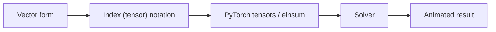
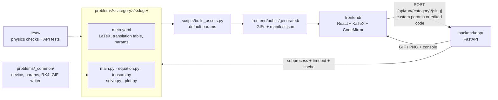

# Tensorizer

**An education tool to study physics equation conversion to tensor form, PyTorch implementation, solving and visualization.**

Tensorizer standardizes the conversion of physics equations into GPU-accelerated tensors through the following workflow:



For example, the projectile with air drag:

```math
m\,\ddot{\mathbf r} = m\,\mathbf g - c\,\lVert\dot{\mathbf r}\rVert\,\dot{\mathbf r}
```

first convert to the tensor notation form:
```math
\ddot x_{bi} = g_i - k\,\sqrt{v_{bj}v_{bj}}\;v_{bi}
```

Here $b$ indexes a batch of balls and $i, j$ are spatial components. The repeated index $j$ is summed, which is exactly `torch.einsum('bj,bj->b', v, v)`. The trajectory solution is integrated via RK4 with animated visualization.

## Problem library

<!-- library:start -->
45 problems in 5 topics, three per difficulty level. Click a topic to expand it.

<details>
<summary><b>Mechanics</b> (9 problems)</summary>

<details>
<summary>🟢 Beginner (3)</summary>

| Problem | Key equation |
|---|---|
| [Simple pendulum beyond small angles](problems/mechanics/simple_pendulum) | $\ddot\theta_b = -\frac{g}{L}\,\sin\theta_b$ |
| [Projectile with air drag](problems/mechanics/projectile) | $\ddot x_{bi} = g_i - \tfrac{c}{m}\,\sqrt{v_{bj}v_{bj}}\;v_{bi}$ |
| [Block on an inclined plane with friction](problems/mechanics/inclined_plane) | $a_{bi} = g_i + \tfrac{1}{m}N_{bi} + \tfrac{1}{m}f_{bi}$ |

</details>

<details>
<summary>🟠 Intermediate (3)</summary>

| Problem | Key equation |
|---|---|
| [Coupled oscillators and normal modes](problems/mechanics/coupled_oscillators) | $m\,\ddot x_i = -K_{ij}\,x_j$ |
| [Double pendulum and chaos](problems/mechanics/double_pendulum) | $M_{bij}(q)\,\ddot q_{bj} = f_{bi}(q, \dot q)$ |
| [Free rigid-body rotation (tennis-racket effect)](problems/mechanics/rigid_body_rotation) | $I_{ij}\,\dot\omega_j + \varepsilon_{ijk}\,\omega_j\,I_{kl}\,\omega_l = 0$ |

</details>

<details>
<summary>🔴 Advanced (3)</summary>

| Problem | Key equation |
|---|---|
| [N-body gravity in 3D](problems/mechanics/n_body_gravity) | $\ddot x_{ai} = G\,m_b\,(r_{abj}r_{abj} + \varepsilon^2)^{-3/2}\,r_{abi}$ |
| [Equations of motion from a Lagrangian by autograd](problems/mechanics/lagrangian_autograd) | $\ddot q_i = H^{-1}_{ij}\Big(\frac{\partial L}{\partial q_j} - C_{jk}\,\dot q_k\Big)$ |
| [Mass–spring cloth](problems/mechanics/mass_spring_cloth) | $m\,\ddot x_{ai} = -k\,D_{ea}\,(\lVert d_e\rVert - \ell_0)\,\hat d_{ei} + m\,g_i$ |

</details>

</details>

<details>
<summary><b>Optics</b> (9 problems)</summary>

<details>
<summary>🟢 Beginner (3)</summary>

| Problem | Key equation |
|---|---|
| [Snell's law in layered media](problems/optics/snell_refraction) | $t_{ri} = \eta_r\,d_{ri} + \left(\eta_r c_r - \sqrt{1-\eta_r^2(1-c_r^2)}\right) n_{ri}$ |
| [Reflection from plane and curved mirrors](problems/optics/mirror_reflection) | $r_{ri} = d_{ri} - 2\,(d_{rj}\,n_{rj})\,n_{ri}$ |
| [Image formed by a thin lens](problems/optics/thin_lens_image) | $s'_k = \left(\frac{1}{f} - \frac{1}{s_k}\right)^{-1}$ |

</details>

<details>
<summary>🟠 Intermediate (3)</summary>

| Problem | Key equation |
|---|---|
| [Two-lens system with ray-transfer matrices](problems/optics/lens_system) | $y'_{ri} = M_{ij}\,y_{rj}$ |
| [Diffraction grating as a sum of phasors](problems/optics/diffraction_grating) | $E_t = A_n\,P_{nt}$ |
| [Polarization with Jones matrices](problems/optics/polarization_jones) | $E^{\text{out}}_i = P_{ij}\,W_{jk}\,E^{\text{in}}_k$ |

</details>

<details>
<summary>🔴 Advanced (3)</summary>

| Problem | Key equation |
|---|---|
| [Double-slit interference](problems/optics/double_slit) | $\partial_t^2 u = c^2\,\partial_i\partial_i u$ |
| [Fraunhofer diffraction as a 2D Fourier transform](problems/optics/fourier_optics) | $U_{kl} = F_{ka}\,A_{ab}\,F_{lb}$ |
| [Road mirage from the ray equation](problems/optics/grin_mirage) | $\frac{d}{ds}\Big(n\,\frac{dr_i}{ds}\Big) = \partial_i n$ |

</details>

</details>

<details>
<summary><b>Thermodynamics</b> (9 problems)</summary>

<details>
<summary>🟢 Beginner (3)</summary>

| Problem | Key equation |
|---|---|
| [Carnot cycle of an ideal gas](problems/thermodynamics/carnot_cycle) | $W = \oint p\,dV,\;\; \eta = 1 - T_c/T_h$ |
| [Newton's law of cooling](problems/thermodynamics/newton_cooling) | $\dot T_b = -k_b\,(T_b - T_{\text{env}})$ |
| [Four ideal-gas processes](problems/thermodynamics/ideal_gas_processes) | $W = \int p\,dV,\;\; Q = \Delta U + W$ |

</details>

<details>
<summary>🟠 Intermediate (3)</summary>

| Problem | Key equation |
|---|---|
| [Heat diffusion on a plate](problems/thermodynamics/heat_diffusion) | $\partial_t T = \alpha\,\partial_i\partial_i T$ |
| [Random walk and diffusion](problems/thermodynamics/random_walk_diffusion) | $\langle x_i x_i\rangle = 2dDt$ |
| [Black-body radiation](problems/thermodynamics/blackbody_radiation) | $u_{ab} = \frac{8\pi h c}{\lambda_b^5}\,\frac{1}{\exp\!\big(hc / \lambda_b k T_a\big) - 1}$ |

</details>

<details>
<summary>🔴 Advanced (3)</summary>

| Problem | Key equation |
|---|---|
| [Kinetic theory of an ideal gas](problems/thermodynamics/kinetic_gas) | $v'_{ai} = v_{ai} - (\Delta v_{abj}\,n_{abj})\,n_{abi}$ |
| [2D Ising model](problems/thermodynamics/ising_model) | $h_{ij} = K_{kl}\,s_{i+k,\,j+l}$ |
| [Van der Waals gas and Maxwell's construction](problems/thermodynamics/van_der_waals) | $p_{tv} = \frac{nRT_t}{V_v - nb} - \frac{an^2}{V_v^2}$ |

</details>

</details>

<details>
<summary><b>Electromagnetism</b> (9 problems)</summary>

<details>
<summary>🟢 Beginner (3)</summary>

| Problem | Key equation |
|---|---|
| [Charged particles in E and B fields](problems/em/lorentz_force) | $m_b\,\dot v_{bi} = q_b\,\big(E_i + \varepsilon_{ijk}\,v_{bj}\,B_k\big)$ |
| [Electric field of point charges](problems/em/coulomb_field) | $E_{gi} = k\,Q_q\,\frac{r_{gqi}}{\big(r_{gqj}\,r_{gqj}\big)^{3/2}}$ |
| [Charging a capacitor (RC circuit)](problems/em/rc_circuit) | $\dot V_b = \frac{V_s - V_b}{R_b\,C}$ |

</details>

<details>
<summary>🟠 Intermediate (3)</summary>

| Problem | Key equation |
|---|---|
| [Electrostatic potential (Poisson equation)](problems/em/electrostatics) | $\partial_i\partial_i\,\phi = -\rho/\varepsilon_0 \;\;\longrightarrow\;\; L_{nm}\,\phi_m = -\rho_n/\varepsilon_0$ |
| [Magnetic field of current loops (Biot–Savart)](problems/em/biot_savart) | $B_{gi} = \frac{\mu_0 I}{4\pi}\,\varepsilon_{ijk}\,dl_{sj}\,\frac{r_{gsk}}{\big(r_{gsl}\,r_{gsl}\big)^{3/2}}$ |
| [Electromagnetic waves (FDTD)](problems/em/em_wave_fdtd) | $\partial_t H_i = -\varepsilon_{ijk}\,\partial_j E_k$ |

</details>

<details>
<summary>🔴 Advanced (3)</summary>

| Problem | Key equation |
|---|---|
| [Lorentz boost of the field tensor](problems/em/field_tensor_boost) | $F'^{\mu\nu} = \Lambda^{\mu}{}_{\alpha}\,\Lambda^{\nu}{}_{\beta}\,F^{\alpha\beta}$ |
| [Relativistic charged particle](problems/em/relativistic_particle) | $\frac{dU^\mu}{d\tau} = \frac{q}{m}\,F^{\mu}{}_{\nu}\,U^\nu$ |
| [Rectangular waveguide modes](problems/em/waveguide_modes) | $\partial_i\partial_i\,\psi + k_c^2\,\psi = 0 \;\;\longrightarrow\;\; -L_{nm}\,\psi_m = k_c^2\,\psi_n$ |

</details>

</details>

<details>
<summary><b>Quantum</b> (9 problems)</summary>

<details>
<summary>🟢 Beginner (3)</summary>

| Problem | Key equation |
|---|---|
| [Particle in a box](problems/quantum/infinite_well) | $H_{xy}\,\varphi_{yn} = E_n\,\varphi_{xn}$ |
| [Quantum harmonic oscillator](problems/quantum/harmonic_oscillator) | $H_{xy}\,\varphi_{yn} = E_n\,\varphi_{xn},\;\; V_x = \tfrac12\omega^2 x^2$ |
| [Free wave packet](problems/quantum/free_wave_packet) | $\tilde\psi_{tk} = e^{-ik_k^2 t_t/2}\,\tilde\psi_k$ |

</details>

<details>
<summary>🟠 Intermediate (3)</summary>

| Problem | Key equation |
|---|---|
| [Spin precession and Rabi flopping](problems/quantum/spin_precession) | $H_{ab} = -\tfrac{\gamma}{2}\,B_k\,\sigma_{kab}$ |
| [Hydrogen atom orbitals](problems/quantum/hydrogen_radial) | $H_{lij}\,u_{ljn} = E_{ln}\,u_{lin}$ |
| [Tunnelling in a double well](problems/quantum/double_well) | $H_{xy}\,\varphi_{yn} = E_n\,\varphi_{xn}$ |

</details>

<details>
<summary>🔴 Advanced (3)</summary>

| Problem | Key equation |
|---|---|
| [Quantum tunnelling](problems/quantum/tunneling) | $\psi_x \leftarrow F^{-1}_{xk}\,K_k\,F_{ky}\,P_y\,\psi_y$ |
| [2D wave-packet scattering](problems/quantum/scattering_2d) | $\psi \leftarrow P\,\mathcal F^{-1} K\,\mathcal F\,P\,\psi$ |
| [Two-qubit entanglement](problems/quantum/two_qubit_entanglement) | $\psi_{ab} \leftarrow G_{abcd}\,\psi_{cd}$ |

</details>

</details>
<!-- library:end -->

Every problem page shows:

1. **Equations**: vector form, index form, and a translation table (symbol → code → tensor shape → meaning).
2. **Code**: five syntax-highlighted files:
   | File | Role |
   |---|---|
   | `main.py` | main loop: parameters → tensors → solve → plot |
   | `equation.py` | physics → tensor translation; the law written with `einsum`, one-to-one with the index form |
   | `tensors.py` | builds the concrete PyTorch tensors (grids, operators, initial states) |
   | `solve.py` | the solver (time stepping, `linalg.solve`, `eigh`, FFT, …) |
   | `plot.py` | 2D/3D matplotlib plot rendered to a GIF (or PNG for static problems) |
3. **Result**: an animated GIF, parameter sliders, a Run button, and the console output.

## Quick start

Requires [pixi](https://pixi.sh). It installs Python, PyTorch, Node.js and everything else into `.pixi/`, so nothing else is needed. It works on Windows, macOS (Apple silicon) and Linux.

```bash
pixi install              # create the environment
pixi run serve            # render all problems, build the site, serve at http://localhost:8000
```

The first `serve` renders every problem, which takes about 6 minutes on a CPU. Later runs re-render only the problems whose code changed. Then open <http://localhost:8000>.

### Development (hot reload)

```bash
pixi run dev              # API + Vite together → http://localhost:5173, Ctrl+C stops both
```

| You edit | What happens |
|---|---|
| `frontend/src/**` | the page updates instantly (React Fast Refresh) |
| `backend/**`, `problems/_common/**` | the API restarts automatically |
| `problems/<category>/<slug>/*.py` or `meta.yaml` | about 1 s later the page reloads with the new code and equations; the GIF re-renders in the background (about 20 s) and the page reloads again |

`pixi run dev` needs port 8000 free, so stop `pixi run serve` first. To run the two servers in separate terminals instead, use `pixi run api` and `pixi run web`.

Other tasks:

```bash
pixi run build-assets     # re-render changed problems → frontend/public/generated/ (add -- --force for all)
pixi run test             # physics checks + API tests
pixi run lint             # ruff
pixi run format
python -m problems.mechanics.projectile.main --out out --params '{"v0": 40}'   # run one problem (inside `pixi shell`)
```

## How it works



| Path | Contents |
|---|---|
| `problems/<category>/<slug>/` | one self-contained package per problem: `meta.yaml` + the five code files |
| `problems/_common/` | device choice, parameter handling, RK4, white-theme GIF writer |
| `scripts/build_assets.py` | renders problems with default params → GIFs + `manifest.json` |
| `backend/app/` | FastAPI: `POST /api/run/{category}/{slug}` re-renders with custom params |
| `frontend/` | React + Vite + TypeScript, KaTeX (equations), CodeMirror (code) |
| `tests/` | per-problem physics checks + API tests |

- **Prebuilt results.** `build_assets.py` renders every problem ahead of time. The site therefore shows results instantly, even with no backend running (static hosting).
- **Re-runs.** The backend runs a problem in a subprocess with a timeout, one render at a time, and caches results by a hash of the parameters (and code).
- **Edited code.** Running your own edits is controlled by `ALLOW_CODE_EXEC=1`. The pixi `api` and `serve` tasks turn it on, because running edited code executes arbitrary Python. Only enable it on your own machine, never on a public server.
- **Physics tests.** Each problem is checked against known results. Examples:

  | Check | Expected |
  |---|---|
  | Projectile range without drag | $R = v_0^2 \sin 2\theta / g$ |
  | Normal-mode frequencies | $\omega_n = 2\sqrt{k/m}\,\sin\frac{n\pi}{2(N+1)}$ |
  | Snell's law | $n_1 \sin\theta_1 = n_2 \sin\theta_2$ |
  | Carnot efficiency | $\eta = 1 - T_c/T_h$ |
  | Infinite-well eigenvalues | $E_n = \dfrac{n^2\pi^2}{2L^2}$ |
  | Larmor frequency | $\omega = \gamma B$ |
  | Field-tensor invariant | $F_{\mu\nu}F^{\mu\nu} = 2(B^2 - E^2)$ |

  Energy and momentum conservation are checked too.

## Adding a problem

1. Copy `problems/mechanics/projectile/` to `problems/<category>/<new_slug>/`.
2. Edit `meta.yaml`: the LaTeX, translation table and parameters. In `summary`, `notes`, the translation `meaning` and parameter `label`, write math as inline LaTeX between `$…$` (for example `$2\times 2$ matrices`); the page typesets it with KaTeX. Use single-quoted or block YAML strings so backslashes survive. Then rewrite the five files, keeping `run(params, out_dir) -> Path` in `main.py`, and add a `diagram.svg` sketch of the setup (viewBox `0 0 240 160`, same style as `simple_pendulum`).
3. Add physics checks to `tests/test_physics_<category>.py`. `tests/test_smoke.py` already checks that every problem follows the convention and renders.
4. Run `pixi run test`, `pixi run build-assets` and `pixi run readme` (refreshes the problem library above).

A new category also needs an entry in `CATEGORIES` in `scripts/build_assets.py`.

## Roadmap

- More problems in every category, then fluid dynamics (Burgers, Navier–Stokes) and continuum mechanics (stress/strain tensors).
- Real datasets: compare simulations with measurements, and fit physical parameters with autograd (inverse problems, PINNs).
- Free-form input: type LaTeX, handwrite, or photograph an equation → translated to tensor form.
- Hosting: GitHub Pages for the static site, plus an optional backend for re-runs.
